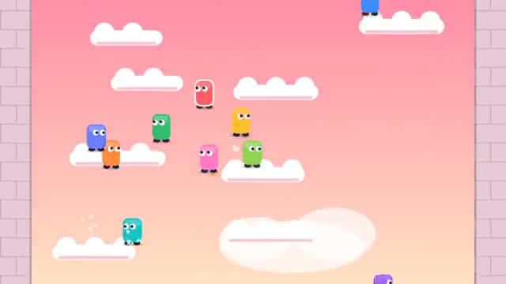

# Sky Climb

Charge your jumps. Climb forever. Try not to fall. A multiplayer starter game from [Multiplayer Agent](https://multiplayeragent.com): 2D, drop-in, 2–20 players, with bots that fill empty seats.

## How it plays

Hold jump to charge and let go to leap: the longer you hold, the higher you fly. Climb an endless tower of platforms with everyone else. Miss a jump and you fall until something catches you. Every 50 m there's a rest ledge and a new part of the tower: Meadow, Treetops, Cloud Sea, Sky Islands, Starfield.

**Controls:** Arrow keys or A/D, hold and release Space, or on-screen ◀ ▶ and Jump.

## Make it yours in the Game Builder

Open the [Game Builder](https://multiplayeragent.com), choose **Start from a starter game** and pick Sky Climb. It opens as version 1 in your studio, ready to play and publish. Then ask for changes, for example:

- Add coins on the platforms and a shop for hats
- Make a wind that blows everyone sideways above 100 m
- Add platforms that crumble a second after you land

## Run it yourself

1. Get a free publishable key (`pk_…`) at [multiplayeragent.com](https://multiplayeragent.com).
2. In `index.html`, put it in place of `pk_REPLACE_ME` in the `MP_CONNECT` block.
3. Open `index.html` in a browser. No build step and no server needed.

Without a key it still runs, offline against bots.

## How it is built

- One `index.html`. The comment at the top of the script maps the code and explains the multiplayer.
- The tower is built from `CONFIG.seed`, so everyone climbs the same one. Change the seed for a new tower.
- **Leaderboard:** The highest anyone has climbed, in meters.
- **Bots:** Bot climbers race up around you until enough people join. The host's browser runs them; if it leaves, the next player takes over.
- **Live sync:** Everyone climbs the same tower, built from one seed, and sees every leap and fall.
- `?attract` runs it offline with bots only. The preview video is recorded from it.

## License

MIT.
